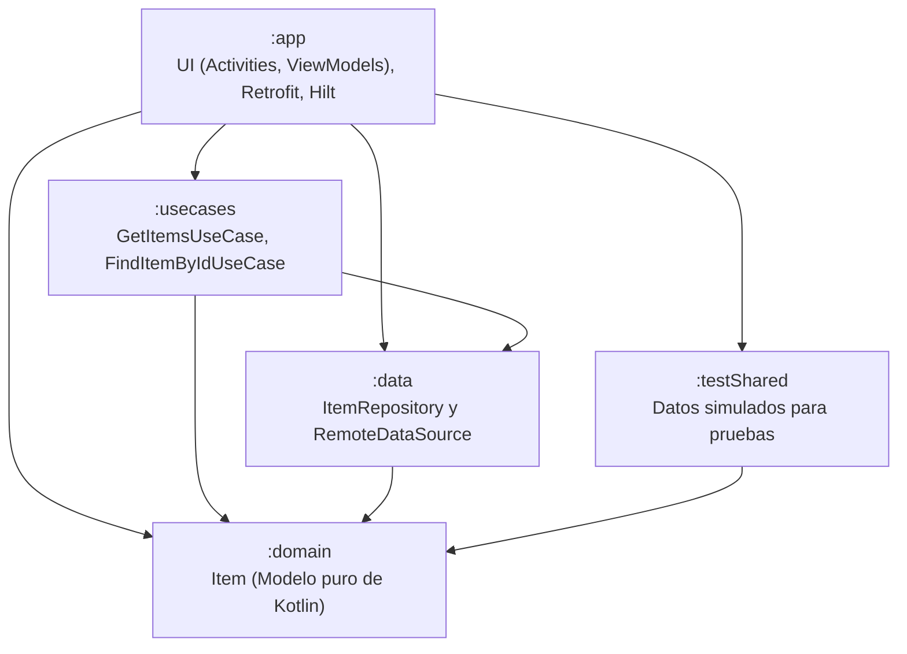

# Documentación Técnica Completa del Proyecto Cervezas (Punk API v3)

Este documento contiene la explicación detallada de la arquitectura, estructura de módulos y desglose archivo por archivo del proyecto Android de búsqueda de cervezas.

---

## 1. Arquitectura General del Proyecto

La aplicación está construida siguiendo la guía de **Clean Architecture** estructurada en 5 módulos independientes de Gradle, combinada con el patrón de diseño **MVVM (Model-View-ViewModel)** e Inyección de Dependencias mediante **Dagger Hilt**.



### Regla fundamental de dependencias
* **El módulo `:domain` no depende de nadie**: No contiene código de Android, ni Retrofit, ni Hilt. Es Kotlin puro.
* **El módulo `:data` solo depende de `:domain`**: Define el contrato del origen de datos y el repositorio.
* **El módulo `:usecases` depende de `:data` y `:domain`**: Define las acciones de negocio.
* **El módulo `:app` es el punto de entrada (Framework)**: Ensambla la interfaz de usuario, la navegación, Retrofit y los módulos de Hilt.

---

## 2. Desglose Archivo por Archivo

### 2.1 Módulo `:domain` (Modelo de Negocio)
Ubicación: `domain/src/main/java/com/example/domain/`

* **`model/Item.kt`**
  * **Qué hace**: Es la clase de datos (`data class`) que representa una cerveza dentro del núcleo del dominio.
  * **Por qué está aquí**: Permite que los casos de uso y la UI trabajen con una entidad pura independiente del JSON de red o de la base de datos.
  * **Campos**: `id`, `name`, `tagline`, `firstBrewed`, `description`, `imageUrl`, `abv`, `ibu`, `foodPairing`.

---

### 2.2 Módulo `:data` (Acceso y Abstracción de Datos)
Ubicación: `data/src/main/java/com/example/data/`

* **`source/RemoteDataSource.kt`**
  * **Qué hace**: Interfaz que establece el contrato para obtener cervezas desde la red.
  * **Por qué está aquí**: Aplica el principio de Inversión de Dependencias (D de SOLID). `:data` no sabe cómo Retrofit realiza las peticiones, solo exige que se cumpla esta interfaz.

* **`repository/ItemRepository.kt`**
  * **Qué hace**: Repositorio concreto de cervezas. Expone las funciones `getItems(query)` y `findItemById(id)` delegando en la abstracción `RemoteDataSource`.
  * **Por qué está aquí**: Es la única fuente de verdad para los casos de uso. Si en el futuro se añade una base de datos local (Room), la lógica se coordinará aquí sin alterar los casos de uso ni la UI.

---

### 2.3 Módulo `:usecases` (Casos de Uso / Lógica de Negocio)
Ubicación: `usecases/src/main/java/com/example/usecases/`

* **`GetItemsUseCase.kt`**
  * **Qué hace**: Representa la acción de obtener el listado de cervezas, permitiendo pasar un parámetro opcional de consulta (`query`) para filtrar en tiempo real.
  * **Por qué está aquí**: Mantiene la regla de "un caso de uso por acción", facilitando la reusabilidad y las pruebas unitarias.

* **`FindItemByIdUseCase.kt`**
  * **Qué hace**: Representa la acción de consultar los detalles de una cerveza específica pasándole su identificador numérico.
  * **Por qué está aquí**: Aisla la lógica de obtención del detalle del resto de la aplicación.

---

### 2.4 Módulo `:testShared` (Mocks de Pruebas)
Ubicación: `testShared/src/main/java/com/example/testshared/`

* **`mocks.kt`**
  * **Qué hace**: Proporciona datos de prueba reutilizables (`mockedItem` y `mockedBeerList`).
  * **Por qué está aquí**: Evita duplicar código de pruebas entre los distintos módulos del proyecto.

---

### 2.5 Módulo `:app` (UI, Framework e Inyección de Dependencias)
Ubicación: `app/src/main/java/com/example/cervezas/`

#### Red y Servidor (`server/`)
* **`BeerDto.kt`**: Data Transfer Object que mapea los nombres exactos de las llaves del JSON de Punk API v3 (`first_brewed`, `food_pairing`, `image`, etc.). Incluye la función de extensión `toDomain()` que construye la URL completa de la imagen (`https://punkapi.dev/api/v3/images/{image}`).
* **`RemoteApiService.kt`**: Interfaz de Retrofit que define las rutas HTTP `@GET("api/v3/beers")` y `@GET("api/v3/beers/{id}")`.
* **`RemoteApi.kt`**: Objeto Singleton que construye el cliente de Retrofit con la Base URL `https://punkapi.dev/` e interceptor de logs.
* **`ServerDataSource.kt`**: Implementación concreta de `RemoteDataSource`. Llama a Retrofit y convierte los `BeerDto` al modelo de dominio `Item`.

#### Inyección de Dependencias (`di/`)
* **`AppModule.kt`**: Entrega la instancia de `RemoteDataSource` (`ServerDataSource`) instalada en el `SingletonComponent`.
* **`DataModule.kt`**: Entrega la instancia de `ItemRepository` instalada en el `SingletonComponent`.
* **`UseCasesModule.kt`**: Entrega las instancias de `GetItemsUseCase` y `FindItemByIdUseCase` instaladas en el `ViewModelComponent`.

#### Interfaz de Usuario (`ui/`)
* **`ui/main/MainViewModel.kt`**: ViewModel de la pantalla principal. Expone el `uiModel` en formato `LiveData`. Gestiona la cancelación de trabajos en vuelo con `Job` al escribir o borrar texto en el buscador.
* **`ui/main/MainActivity.kt`**: Actividad principal. Configura la barra superior, la cuadrícula de 3 columnas (`GridLayoutManager`), infla el menú con `SearchView` e interactúa con el `MainViewModel`. Muestra el mensaje *"No se ha encontrado nada"* cuando la lista está vacía.
* **`ui/main/BeerAdapter.kt`**: Adaptador del `RecyclerView` que infla `item_beer.xml` y carga las imágenes con la librería **Coil** (`binding.beerImage.load(...)`).
* **`ui/detail/DetailViewModel.kt`**: ViewModel de la vista de detalle. Lee el ID enviado por Intent desde `SavedStateHandle` y carga la cerveza correspondiente.
* **`ui/detail/DetailActivity.kt`**: Actividad de detalle. Muestra la flecha de navegación de retorno atrás en la toolbar, la imagen completa de la cerveza centrada en el `ScrollView` sin recortes y los datos clave en formato HTML en negrita.

#### Recursos y Estilos (`res/`)
* **`res/values/colors.xml`**: Define la paleta de tonos Ámbar (`amber_primary`, `amber_primary_dark`, `amber_bg_light`, `amber_bg_dark`, etc.).
* **`res/values/themes.xml` & `res/values-night/themes.xml`**: Configura el tema de la aplicación heredando de `Theme.MaterialComponents.DayNight.DarkActionBar` para dar soporte al ActionBar con flecha atrás y colores de alto contraste.
* **`res/menu/main_menu.xml`**: Menú de la barra superior que contiene el ítem del `SearchView`.
* **`res/layout/activity_main.xml`**: Vista principal con `ProgressBar`, `TextView` de estado vacío y `RecyclerView` de 3 columnas.
* **`res/layout/item_beer.xml`**: Diseño en tarjeta de cada ítem de la cuadrícula (imagen superior y franja de color ámbar oscuro inferior con el nombre).
* **`res/layout/activity_details.xml`**: Diseño en `ScrollView` con la imagen superior amplia (`240dp`) y textos de descripción e información detallada.

---

## 3. Pruebas Unitarias (Unit Tests)

El proyecto incluye pruebas unitarias automatizadas situadas en las carpetas `src/test/` de los módulos correspondientes:

1. **`usecases/src/test/java/com/example/usecases/GetItemsUseCaseTest.kt`**: Verifica que `GetItemsUseCase` devuelve correctamente la lista de cervezas del repositorio.
2. **`usecases/src/test/java/com/example/usecases/FindItemByIdUseCaseTest.kt`**: Verifica que `FindItemByIdUseCase` devuelve la cerveza adecuada según su ID.
3. **`data/src/test/java/com/example/data/ItemRepositoryTest.kt`**: Verifica que `ItemRepository` delega correctamente las llamadas en el `RemoteDataSource`.

Comando para ejecutar las pruebas unitarias:
```bash
./gradlew test
```

---

## 4. Matriz de Cumplimiento de Requisitos del PDF

| Requisito del PDF | Estado | Implementación en el Código |
|---|---|---|
| **Consumo de Punk API** | ✅ Cumplido | Integrado con Punk API v3 (`https://punkapi.dev/api/v3/beers`) |
| **Buscador de cervezas** | ✅ Cumplido | `SearchView` integrado en el encabezado (ActionBar) |
| **Filtro en tiempo real** | ✅ Cumplido | `setOnQueryTextListener` dispara la búsqueda al añadir o borrar cada carácter |
| **Navegación al detalle** | ✅ Cumplido | Al pulsar en una cerveza abre `DetailActivity` pasando el ID por Extra |
| **Información del detalle** | ✅ Cumplido | Muestra nombre, imagen completa, descripción, lema, graduación (ABV), IBU, fecha y maridaje |
| **Diseño en cuadrícula** | ✅ Cumplido | `RecyclerView` con `GridLayoutManager` de 3 columnas e ítem con franja de color |
| **Estado vacío** | ✅ Cumplido | Muestra *"No se ha encontrado nada"* si la búsqueda no arroja resultados |
| **Arquitectura Limpia** | ✅ Cumplido | Separación en 5 módulos (`:domain`, `:data`, `:usecases`, `:app`, `:testShared`) |
| **Inyección de dependencias** | ✅ Cumplido | Dagger Hilt en la capa `:app` (`@HiltAndroidApp`, `@HiltViewModel`, `@Inject`) |
| **Pruebas unitarias** | ✅ Cumplido | 4 tests unitarios en `:usecases` y `:data` ejecutados con JUnit |
| **Lenguaje Kotlin** | ✅ Cumplido | 100% Kotlin con Corrutinas y Flow/LiveData |
