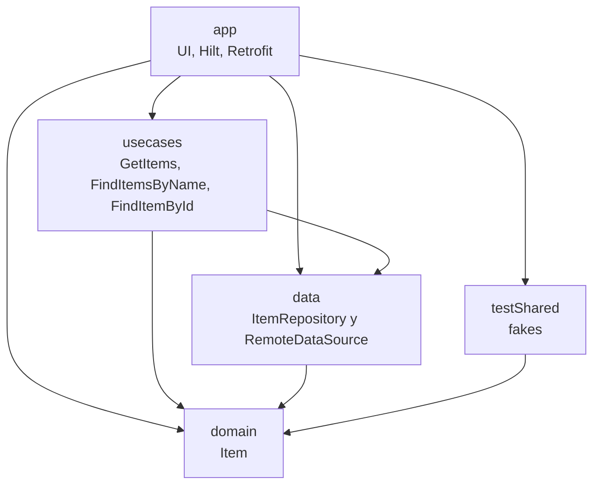

# Guía: empezar un proyecto con Clean Architecture y Dagger Hilt

Esta guía lleva un proyecto Android desde cero hasta una separación de capas en Clean Architecture (al estilo de Antonio Leiva). La inyección de dependencias se hace con **Dagger Hilt**.

Donde hace falta un nombre de paquete, de clase o de recurso, se usa uno genérico. `com.example` no es un dominio real: cuando tengas el tuyo, sustitúyelo en todos los paquetes y deja igual el resto de la estructura.

La figura muestra las capas y la dirección de las dependencias. La interfaz y el framework dependen de los casos de uso. Los casos de uso y los datos dependen del dominio. El dominio no depende de nadie.


Esas capas quedan en cinco módulos:

| Módulo | Qué contiene | De quién depende |
|---|---|---|
| `domain` | El modelo (`Item`). Kotlin puro, sin Android. | De nadie |
| `data` | `ItemRepository` y el contrato `RemoteDataSource` | `domain` |
| `usecases` | Un caso de uso por acción de la aplicación | `data` y `domain` |
| `app` | Pantallas, ViewModels, Retrofit y los módulos de Hilt | `domain`, `data`, `usecases`, `testShared` |
| `testShared` | Datos falsos compartidos por los tests | `domain` |

En el diagrama de módulos, las flechas significan «depende de». `domain` no apunta a nadie: por eso se puede probar y reutilizar sin Android, sin Retrofit y sin Hilt.



El repositorio es una clase concreta dentro de `data`. El contrato de red (`RemoteDataSource`) también vive en `data`. La implementación con Retrofit (`ServerDataSource`) vive en `app`. Esa es la frontera que hay que reproducir.

Los paquetes quedan así:

| Módulo | Paquete |
|---|---|
| `app` | `com.example.app` |
| `domain` | `com.example.domain` |
| `data` | `com.example.data` |
| `usecases` | `com.example.usecases` |
| `testShared` | `com.example.testshared` |

---

## 1. Iniciar el control de versiones correctamente

Haz estos pasos en la carpeta del proyecto. Si Android Studio todavía no ha generado el proyecto, lee esta sección ahora y ejecútala en cuanto exista la carpeta (después del apartado 3, antes de subir nada al remoto).

### 1.1 Modificar el `.gitignore`

Añade estas líneas:

```gitignore
/.idea/*
/domain/build
/data/build
/app/build
```

Cuando más adelante crees `usecases` y `testShared`, añade también sus carpetas de compilación:

```gitignore
/usecases/build
/testShared/build
```

### 1.2 Iniciar Git en local

En la terminal, situada en la raíz del proyecto:

```bash
git init
```

La rama principal es `main`. Todos los comandos de esta guía la usan.

### 1.3 Añadir los archivos

```bash
git add .
```

### 1.4 Primer commit en local

```bash
git commit -m "Primer commit"
```

### 1.5 Enlazar el repositorio remoto

`origin` es un alias. Puedes usar otro nombre. Sustituye la URL por la de tu repositorio:

```bash
git remote add origin https://usuario@servidor.example/usuario/repositorio.git
```

### 1.6 Comprobar el remoto

```bash
git remote -v
```

Muestra el repositorio remoto de trabajo.

### 1.7 Primer push y rama upstream

```bash
git push --set-upstream origin main
```

### 1.8 Push forzado

Este paso solo aplica si el primer push no puede avanzar:

```bash
git push -f --set-upstream origin main
```

`--force` reescribe la historia de `main` en el remoto. Úsalo solo si el remoto tiene commits que no están en local (por ejemplo un `README` creado al dar de alta el repositorio) y aceptas descartar esa historia remota. En el día a día no hace falta.

### 1.9 Colores de estado en Android Studio

Para ver en el editor qué archivos están modificados o sin subir, instala el plugin **GitToolBox**:

1. Android Studio → Settings (Ajustes) → Plugins.
2. Pestaña Marketplace.
3. Busca `GitToolBox`, instálalo y reinicia el IDE.

### 1.10 Actualizar el remoto a partir de ahora

```bash
git push origin main
```

### 1.11 Rama `develop`

Crear la rama y cambiarse a ella:

```bash
git checkout -b develop
```

### 1.12 Trabajar por funcionalidades

La forma de trabajo es crear ramas que partan de `develop`. Cuando la funcionalidad está implementada y comprobada, se integra en `develop` y, si se quiere, se borra la rama.

1. Crear la rama de la característica.
2. Implementarla.
3. Cambiar a `develop` y hacer `git pull` para traer lo que otras personas hayan integrado.
4. Integrar `develop` en la rama de la característica. Si se han tocado los mismos archivos, aparecerán conflictos.
5. Resolver esos conflictos a mano.
6. Cuando esté terminado, el triplete:

```bash
git add .
git commit -m "Descripción del cambio"
git push
```

En ese momento se abre una pull request o, en su defecto, se hace merge de la rama a `develop`.

### 1.13 Error de autenticación por credenciales o token

#### Paso 1. Crear un Personal Access Token

En el hosting de Git: Settings → Developer Settings → Personal Access Token → Generate New Token. Confirma la contraseña, rellena el formulario y pulsa Generate token. Copia el token en ese momento: no se vuelve a mostrar. En GitHub empieza por `ghp_`. No lo pegues en el código, en el `README` ni en un commit.

#### Paso 2. Guardar el token en el sistema

**Windows**

Panel de control → Credential Manager → Windows Credentials → busca la entrada del hosting (en GitHub es `git:https://github.com`) → Edit → en Password pega el token.

Si no existe esa entrada: Add a generic credential → Internet address `git:https://github.com` (o la de tu hosting), tu usuario y, como contraseña, el token → Ok.

**macOS**

Spotlight (la lupa de la barra de menús) → escribe *Keychain Access* (Acceso a Llaveros) → busca el dominio del hosting (`github.com` u otro) → localiza la entrada de contraseña de internet → edítala o bórrala. La próxima vez que Git pida la contraseña, pega el token.

**Linux**

Configura el cliente. Estos comandos cambian la configuración global de Git de tu usuario:

```bash
git config --global user.name "usuario"
git config --global user.email "usuario@example.com"
git config -l
```

Ejemplo de uso:

```bash
git clone https://github.com/USUARIO/REPOSITORIO
```

Cuando pida usuario y contraseña:

- Username: tu usuario.
- Password: el Personal Access Token, no la contraseña de la cuenta.

Para que el equipo recuerde el token durante un tiempo:

```bash
git config --global credential.helper cache
```

Para borrar esa caché:

```bash
git config --global --unset credential.helper
git config --system --unset credential.helper
```

Comprueba el pull:

```bash
git pull -v
```

Clonar metiendo el token en la URL (no dejes esta URL en un script que se vaya a versionar):

```bash
git clone https://<token>@github.com/<usuario>/<repositorio>.git
```

---

## 2. Crear el proyecto en Android Studio

1. Abre Android Studio.
2. **Archivo → Nuevo → Nuevo proyecto** (File → New → New Project).
3. Elige **Phone and Tablet → Empty Views Activity** (Actividad vacía de Views). Esta estructura usa Activities, XML y ViewBinding. No elijas una plantilla de Jetpack Compose.
4. Rellena el formulario:
   - Name: el nombre de la aplicación. No interviene en las capas.
   - Package name: `com.example.app`
   - Save location: la carpeta donde quieras el repo
   - Language: **Kotlin**
   - Minimum SDK: **API 23** o el mínimo que necesite la aplicación
   - Build configuration language: **Kotlin DSL**
5. Pulsa Finish y espera a que termine la sincronización de Gradle.

El asistente deja un único módulo `:app` y, en la raíz, archivos como estos:

- `settings.gradle.kts`
- `build.gradle.kts`
- `gradle/libs.versions.toml`
- `app/build.gradle.kts`

Esta guía edita esos archivos. Si el asistente generara Groovy (`.gradle`), la separación de módulos sería la misma. Los pasos de abajo usan Kotlin DSL (`.kts`).

### 2.1 Versiones que tiene que cumplir Hilt

Hilt 2.60.1 se procesa con KSP. KSP 2.3.14 funciona con el plugin de Kotlin **2.3.20 o superior** (hasta 2.4.x), con Android Gradle Plugin 8.13 o superior y con JDK 17.

Abre `gradle/libs.versions.toml` y mira la versión de Kotlin que generó el asistente.

- Si es `2.3.20` o mayor, déjala.
- Si es anterior, cámbiala a `2.3.20`, sincroniza, y continúa solo cuando el proyecto compile otra vez.

No uses un Android Gradle Plugin 4.x, Kotlin 1.5 ni Gradle 6. Esas versiones no conviven con Hilt actual.

---

## 3. Activar ViewBinding en `app`

En `app/build.gradle.kts`, dentro de `android { }`, añade:

```kotlin
buildFeatures {
    viewBinding = true
}
```

Las pantallas de esta estructura se inflan con ViewBinding.

---

## 4. Crear los módulos de las capas

Repite estos pasos cuatro veces, una por módulo: `domain`, `data`, `usecases`, `testShared`.

1. En la vista Project, clic derecho sobre la raíz del proyecto (el nodo que está por encima de `app`, no sobre `app`).
2. **Nuevo → Módulo** (New → Module).
3. Elige **Java or Kotlin Library** (Biblioteca Java o Kotlin).
4. Module name: el nombre de la tabla (`domain`, luego `data`, luego `usecases`, luego `testShared`).
5. Package name, en el mismo orden:
   - `com.example.domain`
   - `com.example.data`
   - `com.example.usecases`
   - `com.example.testshared`
6. Finish.

Si el asistente crea una clase de ejemplo (`MyClass`, `Library`…), bórrala.

En `settings.gradle.kts` deben quedar los cinco módulos. El asistente suele añadir el `include` al crear cada uno. Comprueba que el archivo contiene esto (puede haber más líneas: no las borres):

```kotlin
include(":app")
include(":domain")
include(":data")
include(":usecases")
include(":testShared")
```

### 4.1 Plugin de Kotlin para módulos que no son Android

`domain`, `data` y `usecases` no llevan el plugin de Android. Así `domain` no puede depender de `Context`, recursos ni del SDK.

En `gradle/libs.versions.toml`, dentro de `[plugins]`, añade una línea. Usa la misma `version.ref` de Kotlin que ya tenga el archivo (en el bloque de abajo se llama `kotlin`; si la tuya tiene otro nombre, reutilízalo):

```toml
kotlin-jvm = { id = "org.jetbrains.kotlin.jvm", version.ref = "kotlin" }
```

En el `build.gradle.kts` de la raíz, dentro de `plugins { }`, añade:

```kotlin
alias(libs.plugins.kotlin.jvm) apply false
```

`apply false` solo declara el plugin. Cada módulo lo aplica en su propio archivo.

### 4.2 `domain/build.gradle.kts`

Sustituye el contenido generado por este. `domain` solo tiene la librería estándar de Kotlin:

```kotlin
plugins {
    id("java-library")
    alias(libs.plugins.kotlin.jvm)
}

java {
    sourceCompatibility = JavaVersion.VERSION_17
    targetCompatibility = JavaVersion.VERSION_17
}

kotlin {
    compilerOptions {
        jvmTarget.set(org.jetbrains.kotlin.gradle.dsl.JvmTarget.JVM_17)
    }
}

dependencies {
}
```

### 4.3 `data/build.gradle.kts`

`data` publica `domain` hacia quien dependa de `data` (`api`):

```kotlin
plugins {
    id("java-library")
    alias(libs.plugins.kotlin.jvm)
}

java {
    sourceCompatibility = JavaVersion.VERSION_17
    targetCompatibility = JavaVersion.VERSION_17
}

kotlin {
    compilerOptions {
        jvmTarget.set(org.jetbrains.kotlin.gradle.dsl.JvmTarget.JVM_17)
    }
}

dependencies {
    api(project(":domain"))
}
```

### 4.4 `usecases/build.gradle.kts`

Los casos de uso dependen del repositorio concreto (`data`) y del modelo (`domain`):

```kotlin
plugins {
    id("java-library")
    alias(libs.plugins.kotlin.jvm)
}

java {
    sourceCompatibility = JavaVersion.VERSION_17
    targetCompatibility = JavaVersion.VERSION_17
}

kotlin {
    compilerOptions {
        jvmTarget.set(org.jetbrains.kotlin.gradle.dsl.JvmTarget.JVM_17)
    }
}

dependencies {
    api(project(":data"))
    api(project(":domain"))
}
```

### 4.5 `testShared/build.gradle.kts`

Este módulo no es una librería Java de producción. Solo comparte fakes de test y depende de `domain`:

```kotlin
plugins {
    alias(libs.plugins.kotlin.jvm)
}

kotlin {
    compilerOptions {
        jvmTarget.set(org.jetbrains.kotlin.gradle.dsl.JvmTarget.JVM_17)
    }
}

dependencies {
    implementation(project(":domain"))
}
```

### 4.6 Dependencias del módulo `app`

En `app/build.gradle.kts`, dentro de `dependencies { }`, añade los módulos. En un módulo `application` la configuración que existe es `implementation`. El grafo es el mismo, porque nadie depende de `app`:

```kotlin
implementation(project(":domain"))
implementation(project(":data"))
implementation(project(":usecases"))
implementation(project(":testShared"))
```

Sincroniza Gradle. Tiene que terminar sin errores antes de seguir. En este punto los módulos están vacíos de código propio: eso es normal.

---

## 5. Código de cada capa

Crea cada archivo en `src/main/java` del módulo, respetando el paquete. Si el asistente generó `src/main/kotlin` en lugar de `src/main/java`, usa esa carpeta y no mezcles las dos.

`Item` es el modelo genérico. En una aplicación real será la entidad de tu dominio (`Pedido`, `Nota`, `Producto`…), con los campos que necesite. La guía usa tres campos para que el resto de capas tenga algo que transportar.

### 5.1 Modelo de dominio, DTO y DBO

La misma información puede tener hasta tres formas. Cada una vive en una capa distinta y solo el repositorio pasa de una a otra.

| Forma | Qué representa | Dónde vive |
|---|---|---|
| Modelo de dominio | Lo que conocen el repositorio, los casos de uso y la interfaz | `domain` |
| DTO (Data Transfer Object) | La forma de los datos al cruzar la red. Sus campos siguen el JSON del servicio: nombres, anidación y campos que la aplicación no usa | `app`, junto a Retrofit |
| DBO (Database Object) | La fila que se guarda en local, por ejemplo una `@Entity` de Room. Tiene clave primaria, nombres de columna y relaciones de la tabla | El data source local, en `app` o en `data` si esa capa ya conoce la base de datos |

El modelo de dominio no sabe de JSON ni de columnas. Un DTO no entra en `domain` ni en los casos de uso. Un DBO tampoco.

El repositorio es la frontera. Recibe un DTO o un DBO y entrega el modelo de dominio. La función que copia un objeto en el otro se queda en la implementación del data source (`app`) o en el repositorio (`data`). `domain` no importa ninguna de las dos clases.

En esta guía las tres formas coinciden y no hay base de datos local, así que basta una clase: `Item`. Retrofit deserializa el JSON directamente sobre el modelo de dominio y no hace falta mapeo.

Cuando el JSON o la tabla no coincidan con lo que la aplicación necesita, sepáralas. El servicio puede devolver `item_name` y una lista anidada, y la tabla puede llamar `title` a esa misma cadena. El modelo de dominio sigue llamándose `name`. El data source traduce:

```kotlin
fun ItemDto.toDomain() = Item(
    id = id,
    name = itemName,
    description = description
)

fun Item.toDbo() = ItemDbo(
    id = id,
    title = name,
    description = description.orEmpty()
)
```

`ItemDto` se declara al lado de la interfaz de Retrofit. `ItemDbo` se declara al lado de la base de datos. `RemoteDataSource` y `ItemRepository` siguen hablando solo de `Item`. Los pasos siguientes de esta guía usan el caso simple, el de una sola clase.

### 5.2 `domain`: el modelo

`domain/src/main/java/com/example/domain/model/Item.kt`

Como aquí el modelo de dominio también hace de DTO, los nombres de los campos coinciden con el JSON del servicio. Si en tu servicio no coinciden, deja estos nombres en `domain` y crea el DTO en `app`, como en el apartado 5.1.

```kotlin
package com.example.domain.model

data class Item(
    val id: Int,
    val name: String,
    val description: String?
)
```

`domain` no importa `android.*`, Retrofit, Hilt ni los otros módulos.

### 5.3 `data`: contrato y repositorio

`data/src/main/java/com/example/data/source/RemoteDataSource.kt`

```kotlin
package com.example.data.source

import com.example.domain.model.Item

interface RemoteDataSource {
    suspend fun getItems(): List<Item>
    suspend fun findItemsByName(name: String): List<Item>
    suspend fun findItemById(id: Int): List<Item>
}
```

`data/src/main/java/com/example/data/repository/ItemRepository.kt`

```kotlin
package com.example.data.repository

import com.example.data.source.RemoteDataSource
import com.example.domain.model.Item

class ItemRepository(private val remoteDataSource: RemoteDataSource) {

    suspend fun getItems(): List<Item> = remoteDataSource.getItems()

    suspend fun findItemsByName(name: String): List<Item> =
        remoteDataSource.findItemsByName(name)

    suspend fun findItemById(id: Int): List<Item> =
        remoteDataSource.findItemById(id)
}
```

El repositorio no sabe si los datos vienen de Retrofit, de una base de datos o de un fake. Solo conoce `RemoteDataSource`.

### 5.4 `usecases`: una clase por acción

`usecases/src/main/java/com/example/usecases/GetItemsUseCase.kt`

```kotlin
package com.example.usecases

import com.example.data.repository.ItemRepository
import com.example.domain.model.Item

class GetItemsUseCase(private val repository: ItemRepository) {
    suspend fun invoke(): List<Item> = repository.getItems()
}
```

`usecases/src/main/java/com/example/usecases/FindItemsByNameUseCase.kt`

```kotlin
package com.example.usecases

import com.example.data.repository.ItemRepository
import com.example.domain.model.Item

class FindItemsByNameUseCase(private val repository: ItemRepository) {
    suspend fun invoke(name: String): List<Item> = repository.findItemsByName(name)
}
```

`usecases/src/main/java/com/example/usecases/FindItemByIdUseCase.kt`

```kotlin
package com.example.usecases

import com.example.data.repository.ItemRepository
import com.example.domain.model.Item

class FindItemByIdUseCase(private val repository: ItemRepository) {
    suspend fun invoke(id: Int): List<Item> = repository.findItemById(id)
}
```

Ninguna de estas clases lleva anotaciones de Hilt. La inyección se configura en `app`.

### 5.5 `testShared`: un fake del modelo

`testShared/src/main/java/com/example/testshared/mocks.kt`

```kotlin
package com.example.testshared

import com.example.domain.model.Item

val mockedItem = Item(
    id = 1,
    name = "Elemento de prueba",
    description = "Descripción de prueba"
)
```

---

## 6. La capa `app`: framework e inyección con Hilt

En `app` viven lo que Android y las librerías obligan a conocer: `Application`, Activities, ViewModels, Retrofit y los módulos de Hilt.

### 6.1 Catálogo de versiones

En `gradle/libs.versions.toml` añade las versiones y las librerías que falten. Si una clave ya existe, no la dupliques: reutiliza la del asistente.

```toml
[versions]
hilt = "2.60.1"
ksp = "2.3.14"
retrofit = "2.9.0"
okhttp = "4.12.0"
coroutines = "1.9.0"
lifecycle = "2.8.7"

[libraries]
hilt-android = { group = "com.google.dagger", name = "hilt-android", version.ref = "hilt" }
hilt-compiler = { group = "com.google.dagger", name = "hilt-compiler", version.ref = "hilt" }
retrofit = { group = "com.squareup.retrofit2", name = "retrofit", version.ref = "retrofit" }
retrofit-converter-gson = { group = "com.squareup.retrofit2", name = "converter-gson", version.ref = "retrofit" }
okhttp-logging = { group = "com.squareup.okhttp3", name = "logging-interceptor", version.ref = "okhttp" }
coroutines-android = { group = "org.jetbrains.kotlinx", name = "kotlinx-coroutines-android", version.ref = "coroutines" }
lifecycle-viewmodel-ktx = { group = "androidx.lifecycle", name = "lifecycle-viewmodel-ktx", version.ref = "lifecycle" }
lifecycle-livedata-ktx = { group = "androidx.lifecycle", name = "lifecycle-livedata-ktx", version.ref = "lifecycle" }

[plugins]
hilt = { id = "com.google.dagger.hilt.android", version.ref = "hilt" }
ksp = { id = "com.google.devtools.ksp", version.ref = "ksp" }
```

El bloque `[plugins]` del asistente ya tiene otras entradas. Añade `hilt` y `ksp` junto a ellas. `kotlin-jvm` se añadió en el apartado 4.1.

### 6.2 Declarar los plugins en la raíz

En el `build.gradle.kts` de la raíz, dentro de `plugins { }`:

```kotlin
alias(libs.plugins.hilt) apply false
alias(libs.plugins.ksp) apply false
```

### 6.3 Aplicar Hilt solo en `app`

Al principio de `app/build.gradle.kts`, en `plugins { }`:

```kotlin
alias(libs.plugins.ksp)
alias(libs.plugins.hilt)
```

Y en `dependencies { }`, además de los cuatro `implementation(project(...))` del apartado 4.6:

```kotlin
implementation(libs.hilt.android)
ksp(libs.hilt.compiler)

implementation(libs.retrofit)
implementation(libs.retrofit.converter.gson)
implementation(libs.okhttp.logging)
implementation(libs.coroutines.android)
implementation(libs.lifecycle.viewmodel.ktx)
implementation(libs.lifecycle.livedata.ktx)
```

Hilt exige Java 17. Dentro de `android { }` del mismo archivo, deja (o añade) esto:

```kotlin
compileOptions {
    sourceCompatibility = JavaVersion.VERSION_17
    targetCompatibility = JavaVersion.VERSION_17
}

kotlin {
    compilerOptions {
        jvmTarget.set(org.jetbrains.kotlin.gradle.dsl.JvmTarget.JVM_17)
    }
}
```

Si el archivo generado todavía usa `kotlinOptions { jvmTarget = "11" }`, sustitúyelo por el bloque `kotlin { compilerOptions { ... } }` de arriba.

No apliques el plugin de Hilt en `domain`, `data`, `usecases` ni `testShared`.

### 6.4 Permiso de red

En `app/src/main/AndroidManifest.xml`, como hijo directo de `<manifest>`:

```xml
<uses-permission android:name="android.permission.INTERNET" />
```

### 6.5 Retrofit, el detalle de framework

Estos archivos implementan `RemoteDataSource`. Por eso están en `app` y no en `data`. La URL y las rutas son genéricas: cámbialas por las de tu servicio.

`app/src/main/java/com/example/app/server/RemoteApiService.kt`

```kotlin
package com.example.app.server

import com.example.domain.model.Item
import retrofit2.http.GET
import retrofit2.http.Query

interface RemoteApiService {

    @GET("items")
    suspend fun getItems(): List<Item>

    @GET("items")
    suspend fun findItemsByName(@Query("name") name: String): List<Item>

    @GET("items")
    suspend fun findItemById(@Query("id") id: String): List<Item>
}
```

`app/src/main/java/com/example/app/server/RemoteApi.kt`

```kotlin
package com.example.app.server

import okhttp3.OkHttpClient
import okhttp3.logging.HttpLoggingInterceptor
import retrofit2.Retrofit
import retrofit2.converter.gson.GsonConverterFactory

object RemoteApi {

    private val okHttpClient = OkHttpClient.Builder()
        .addInterceptor(HttpLoggingInterceptor().setLevel(HttpLoggingInterceptor.Level.BODY))
        .build()

    val service: RemoteApiService = Retrofit.Builder()
        .baseUrl("https://api.example.com/")
        .client(okHttpClient)
        .addConverterFactory(GsonConverterFactory.create())
        .build()
        .create(RemoteApiService::class.java)
}
```

`app/src/main/java/com/example/app/server/ServerDataSource.kt`

```kotlin
package com.example.app.server

import com.example.data.source.RemoteDataSource
import com.example.domain.model.Item

class ServerDataSource : RemoteDataSource {
    override suspend fun getItems(): List<Item> =
        RemoteApi.service.getItems()

    override suspend fun findItemsByName(name: String): List<Item> =
        RemoteApi.service.findItemsByName(name)

    override suspend fun findItemById(id: Int): List<Item> =
        RemoteApi.service.findItemById(id.toString())
}
```

### 6.6 Módulos de Hilt

`AppModule` entrega el `RemoteDataSource` y `DataModule` entrega el `ItemRepository`. Esos `@Provides` se instalan en `SingletonComponent`, el contenedor que vive lo que vive la aplicación. `@HiltAndroidApp` lo genera.

`app/src/main/java/com/example/app/di/AppModule.kt`

```kotlin
package com.example.app.di

import com.example.app.server.ServerDataSource
import com.example.data.source.RemoteDataSource
import dagger.Module
import dagger.Provides
import dagger.hilt.InstallIn
import dagger.hilt.components.SingletonComponent
import javax.inject.Singleton

@Module
@InstallIn(SingletonComponent::class)
object AppModule {

    @Provides
    @Singleton
    fun remoteDataSourceProvider(): RemoteDataSource = ServerDataSource()
}
```

`app/src/main/java/com/example/app/di/DataModule.kt`

```kotlin
package com.example.app.di

import com.example.data.repository.ItemRepository
import com.example.data.source.RemoteDataSource
import dagger.Module
import dagger.Provides
import dagger.hilt.InstallIn
import dagger.hilt.components.SingletonComponent
import javax.inject.Singleton

@Module
@InstallIn(SingletonComponent::class)
object DataModule {

    @Provides
    @Singleton
    fun repositoryProvider(remoteDataSource: RemoteDataSource) =
        ItemRepository(remoteDataSource)
}
```

Los casos de uso se instalan en `ViewModelComponent`. Ese contenedor vive lo que vive el ViewModel y puede usar lo que ya está en `SingletonComponent` (el repositorio).

`app/src/main/java/com/example/app/di/UseCasesModule.kt`

```kotlin
package com.example.app.di

import com.example.data.repository.ItemRepository
import com.example.usecases.FindItemByIdUseCase
import com.example.usecases.FindItemsByNameUseCase
import com.example.usecases.GetItemsUseCase
import dagger.Module
import dagger.Provides
import dagger.hilt.InstallIn
import dagger.hilt.android.components.ViewModelComponent

@Module
@InstallIn(ViewModelComponent::class)
object UseCasesModule {

    @Provides
    fun getItemsUseCaseProvider(repository: ItemRepository) =
        GetItemsUseCase(repository)

    @Provides
    fun findItemsByNameUseCaseProvider(repository: ItemRepository) =
        FindItemsByNameUseCase(repository)

    @Provides
    fun findItemByIdUseCaseProvider(repository: ItemRepository) =
        FindItemByIdUseCase(repository)
}
```

### 6.7 `Application`

Crea `app/src/main/java/com/example/app/App.kt`:

```kotlin
package com.example.app

import android.app.Application
import dagger.hilt.android.HiltAndroidApp

@HiltAndroidApp
class App : Application()
```

`@HiltAndroidApp` genera el contenedor de dependencias y lo asocia a la `Application`. Las Activities no guardan ni consultan ese contenedor.

En el `<application>` del manifest añade el nombre de la clase:

```xml
<application
    android:name=".App"
    ... >
```

### 6.8 ViewModels

El ViewModel de listado recibe los casos de uso por constructor. Hilt lo crea, así que no hace falta un `@Provides` que lo instancie.

`app/src/main/java/com/example/app/ui/main/MainViewModel.kt`

```kotlin
package com.example.app.ui.main

import androidx.lifecycle.LiveData
import androidx.lifecycle.MutableLiveData
import androidx.lifecycle.ViewModel
import androidx.lifecycle.viewModelScope
import com.example.domain.model.Item
import com.example.usecases.FindItemsByNameUseCase
import com.example.usecases.GetItemsUseCase
import dagger.hilt.android.lifecycle.HiltViewModel
import kotlinx.coroutines.launch
import javax.inject.Inject

@HiltViewModel
class MainViewModel @Inject constructor(
    private val getItemsUseCase: GetItemsUseCase,
    private val findItemsByNameUseCase: FindItemsByNameUseCase
) : ViewModel() {

    sealed class UiModel {
        data object Loading : UiModel()
        data class Content(val items: List<Item>) : UiModel()
        data class Navigation(val item: Item) : UiModel()
    }

    private val _uiModel = MutableLiveData<UiModel>()
    val uiModel: LiveData<UiModel>
        get() {
            if (_uiModel.value == null) refresh()
            return _uiModel
        }

    fun refresh() {
        viewModelScope.launch {
            _uiModel.value = UiModel.Loading
            _uiModel.value = UiModel.Content(getItemsUseCase.invoke())
        }
    }

    fun onItemClicked(item: Item) {
        _uiModel.value = UiModel.Navigation(item)
    }

    fun doSearch(query: String) {
        viewModelScope.launch {
            _uiModel.value = UiModel.Loading
            _uiModel.value = UiModel.Content(findItemsByNameUseCase.invoke(query))
        }
    }

    fun cleanSearch() {
        viewModelScope.launch {
            _uiModel.value = UiModel.Loading
            _uiModel.value = UiModel.Content(emptyList())
        }
    }
}
```

El id del elemento viaja en el `Intent` de la Activity. El ViewModel lo lee de `SavedStateHandle`, que Hilt entrega a cada clase marcada con `@HiltViewModel`.

`app/src/main/java/com/example/app/ui/detail/DetailViewModel.kt`

```kotlin
package com.example.app.ui.detail

import androidx.lifecycle.LiveData
import androidx.lifecycle.MutableLiveData
import androidx.lifecycle.SavedStateHandle
import androidx.lifecycle.ViewModel
import androidx.lifecycle.viewModelScope
import com.example.domain.model.Item
import com.example.usecases.FindItemByIdUseCase
import dagger.hilt.android.lifecycle.HiltViewModel
import kotlinx.coroutines.launch
import javax.inject.Inject

@HiltViewModel
class DetailViewModel @Inject constructor(
    savedStateHandle: SavedStateHandle,
    private val findItemByIdUseCase: FindItemByIdUseCase
) : ViewModel() {

    private val itemId: Int = savedStateHandle.get<Int>(ITEM_ID) ?: -1

    sealed class UiModel {
        data object Loading : UiModel()
        data class Content(val items: List<Item>) : UiModel()
    }

    private val _uiModel = MutableLiveData<UiModel>()
    val uiModel: LiveData<UiModel>
        get() {
            if (_uiModel.value == null) findItem()
            return _uiModel
        }

    fun findItem() {
        viewModelScope.launch {
            _uiModel.value = UiModel.Loading
            _uiModel.value = UiModel.Content(findItemByIdUseCase.invoke(itemId))
        }
    }

    companion object {
        const val ITEM_ID = "DetailActivity:item"
    }
}
```

La Activity de detalle tiene que abrir el `Intent` con esa misma clave.

### 6.9 Activities: cómo se pide el ViewModel

El asistente ya creó una `MainActivity` en el paquete raíz. Muévela a `com.example.app.ui.main` (clic derecho → Refactor → Move) o crea la clase en ese paquete y borra la anterior. Actualiza el `android:name` del manifest si cambia el paquete.

La Activity pide el ViewModel así:

```kotlin
package com.example.app.ui.main

import android.os.Bundle
import androidx.activity.viewModels
import androidx.appcompat.app.AppCompatActivity
import dagger.hilt.android.AndroidEntryPoint

@AndroidEntryPoint
class MainActivity : AppCompatActivity() {

    private val mainViewModel: MainViewModel by viewModels()

    override fun onCreate(savedInstanceState: Bundle?) {
        super.onCreate(savedInstanceState)
        // RecyclerView, búsqueda y ViewBinding se quedan en esta Activity.
        // Cuando haga falta cargar: mainViewModel.refresh()
        // Cuando el usuario elige un elemento, el ViewModel emite Navigation
        // y desde aquí se abre DetailActivity con el id:
        //
        // startActivity(
        //     Intent(this, DetailActivity::class.java)
        //         .putExtra(DetailViewModel.ITEM_ID, item.id)
        // )
    }
}
```

Crea la Activity de detalle (**Archivo → Nuevo → Activity → Empty Views Activity**) en el paquete `com.example.app.ui.detail`, o créala a mano y regístrala en el manifest.

```kotlin
package com.example.app.ui.detail

import android.os.Bundle
import androidx.activity.viewModels
import androidx.appcompat.app.AppCompatActivity
import dagger.hilt.android.AndroidEntryPoint

@AndroidEntryPoint
class DetailActivity : AppCompatActivity() {

    private val detailViewModel: DetailViewModel by viewModels()

    override fun onCreate(savedInstanceState: Bundle?) {
        super.onCreate(savedInstanceState)
        // El id ya está en el Intent. SavedStateHandle se lo entrega
        // al DetailViewModel. findItem() se dispara al observar uiModel.
    }
}
```

El layout y el adaptador se quedan en `app`. No se mueven a `domain`, `data` ni `usecases`.

`by viewModels()` viene de `androidx.activity`. La plantilla Empty Views Activity ya depende de esa librería. El import es `androidx.activity.viewModels`.

---

## 7. Dónde queda cada pieza

| Pieza | Dónde |
|---|---|
| `Item` | `domain` |
| `RemoteDataSource` e `ItemRepository` | `data` |
| Los tres casos de uso | `usecases` |
| `mockedItem` | `testShared` |
| `ServerDataSource`, Retrofit, Activities y ViewModels | `app` |
| `@HiltAndroidApp` | `App` |
| `AppModule` y `DataModule` | `SingletonComponent` |
| `UseCasesModule` | `ViewModelComponent` |
| `MainActivity` y `DetailActivity` | `@AndroidEntryPoint` y `by viewModels()` |
| Id del detalle | Extra del `Intent`, leído con `SavedStateHandle` |

---

## 8. Compilar y comprobar que las capas quedaron separadas

1. Pulsa **Sync Project with Gradle Files**.
2. **Compilar → Compilar proyecto** (Build → Make Project).

Tiene que terminar sin errores. Si KSP dice que la versión no encaja con Kotlin, vuelve al apartado 2.1: la versión de KSP 2.3.14 pide Kotlin 2.3.20 o superior.

Comprueba el grafo con estos criterios:

- `domain` no importa Android, Retrofit ni Hilt.
- `data` solo depende de `:domain`. No hay Retrofit en ese módulo.
- `usecases` depende de `:data` y `:domain`, y no conoce Activities ni ViewModels.
- `ServerDataSource` está en `app` e implementa `RemoteDataSource`.
- `App` tiene `@HiltAndroidApp` y está declarada en el manifest con `android:name=".App"`.
- `MainActivity` y `DetailActivity` tienen `@AndroidEntryPoint`.
- `MainViewModel` y `DetailViewModel` tienen `@HiltViewModel` y `@Inject constructor`.

A partir de aquí las pantallas se construyen dentro de `app`, pidiendo datos solo a través de los casos de uso. Un caso de uso nuevo es una clase en `usecases`, un `@Provides` en `UseCasesModule` y un parámetro más en el ViewModel que lo necesite.
